<div align="center">

# KoboldCpp Vector Database

Let the AI you run in [KoboldCpp](https://github.com/LostRuins/koboldcpp) search your own documents, and the KoboldCpp wiki, while you chat.

</div>

<p align="center">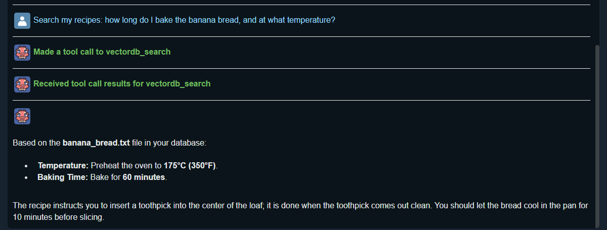</p>

This program plugs into KoboldCpp through MCP (Model Context Protocol), KoboldCpp's way of letting a model use outside tools. Once it's connected, you can ask the AI in Kobold Lite to:

- **search** a vector database of your files and answer from the passages it finds, naming the files they came from;
- **create** a new database from files and folders on your computer;
- **list** your databases, and check on or stop a database that's being created.

It comes with **kobold_wiki**, a ready-made database of the entire official KoboldCpp wiki, so you can ask KoboldCpp questions as soon as it's set up.

## Contents

- [What you need](#what-you-need)
- [Part 1: Install the program](#part-1-install-the-program)
- [Part 2: Start KoboldCpp with the program](#part-2-start-koboldcpp-with-the-program)
- [Part 3: Turn on tool calling in Kobold Lite](#part-3-turn-on-tool-calling-in-kobold-lite)
- [Part 4: Ask questions](#part-4-ask-questions)
- [Next time](#next-time)
- [Tips](#tips)
- [The command line](#the-command-line)
- [Keeping the KoboldCpp wiki database current](#keeping-the-koboldcpp-wiki-database-current)
- [Troubleshooting](#troubleshooting)

## What you need

- **Windows** 10 or 11.
- **Python** [3.11, 3.12, 3.13 or 3.14](https://www.python.org/downloads/windows/) (the standard version, not the free-threaded one). When you install it, tick **Add python.exe to PATH**.
- **[Git](https://git-scm.com/downloads)**.
- **[Microsoft C++ Build Tools](https://visualstudio.microsoft.com/visual-cpp-build-tools/)** with the **Desktop development with C++** workload.
- **[KoboldCpp](https://github.com/LostRuins/koboldcpp/releases/latest)** 1.106 or newer (this guide uses 1.123), and a GGUF model that can use tools. This guide uses Qwen3.5 4B.
- About **12 GB of free disk space**: roughly 7 GB for the program's libraries, 1.2 GB for the embedding model that searches the wiki, and room for the installer's downloads.
- An **NVIDIA graphics card** is recommended. Without one the program still works, but creating databases is slower.

## Part 1: Install the program

### Step 1: Download the program

Download the latest release from the [Releases page](https://github.com/BBC-Esq/VectorDB-Plugin-for-KoboldAI/releases/latest) (under **Assets**, choose **Source code (zip)**) and unzip it to a short folder path that uses only English letters and numbers, for example `C:\VectorDB-Plugin-for-KoboldAI`. Inside, you'll find a `src` folder.

### Step 2: Open a command prompt in the src folder

Open the `src` folder in File Explorer, click the address bar, type `cmd` and press Enter. A command prompt opens in that folder.

### Step 3: Create and activate a virtual environment

Type these two commands, pressing Enter after each:

```bash
python -m venv .
```

```bash
.\Scripts\activate
```

The prompt now starts with `(src)`.

### Step 4: Run the installer

```bash
python setup_windows.py
```

The installer first asks four questions. Click **Yes** on each one. (The second one describes your graphics card, so its wording may differ.)

<p align="center">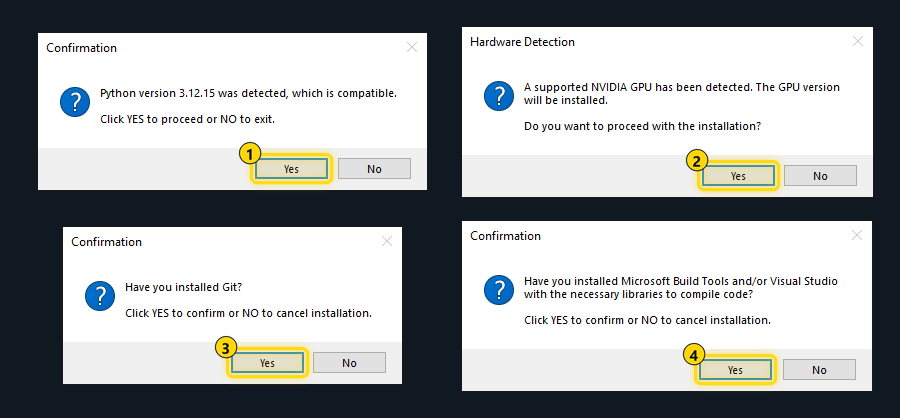</p>

It then installs everything the program needs, which can take a while since most of it is downloaded. At the end it downloads Yuan-embedding-2.0-en, the embedding model that searches the KoboldCpp wiki database, and saves a file called `mcp.json` in the folder you unzipped (next to `src`). The last lines look like this:

```
Saved C:\VectorDB-Plugin-for-KoboldAI\mcp.json
Load it in KoboldCpp's launcher: open the Loaded Files tab and choose this file as the MCP JSON file.
```

`mcp.json` tells KoboldCpp how to start this program. You'll pick it in KoboldCpp's launcher in Step 7.

## Part 2: Start KoboldCpp with the program

### Step 5: Download KoboldCpp and a model

From the [KoboldCpp releases page](https://github.com/LostRuins/koboldcpp/releases/latest), download `koboldcpp.exe` if you have an NVIDIA graphics card, `koboldcpp-nocuda.exe` if you don't, or `koboldcpp-oldpc.exe` for an older computer.

You also need a model in GGUF format. This guide uses `Qwen3.5-4B-Q4_K_M.gguf` (2.7 GB) from [unsloth/Qwen3.5-4B-GGUF](https://huggingface.co/unsloth/Qwen3.5-4B-GGUF) (open **Files and versions** and click the download arrow next to the file).

### Step 6: Choose your model

Double-click `koboldcpp.exe`. In the launcher's **Quick Launch** tab, click **Browse** next to **GGUF Text Model** and pick the model file.

<p align="center">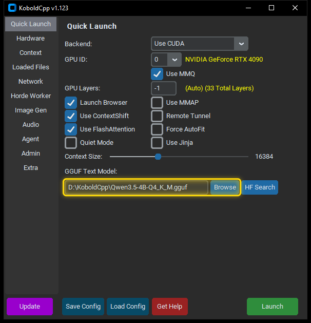</p>

### Step 7: Load mcp.json

1. Click **Loaded Files** in the list on the left.
2. Click **Browse** next to **MCP JSON** and pick the `mcp.json` file from Step 4.

<p align="center">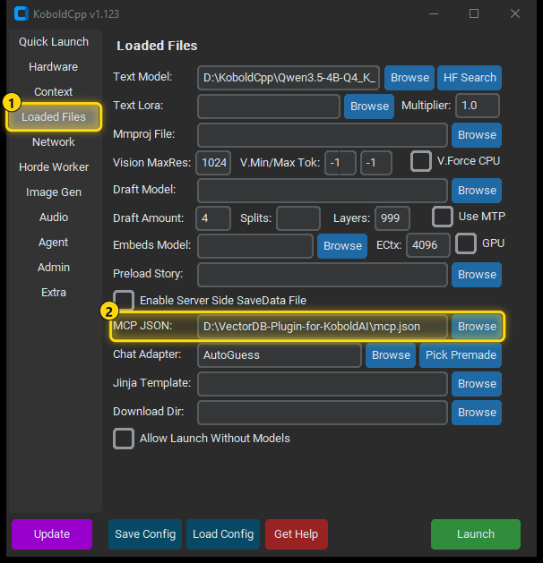</p>

### Step 8: Launch

Click **Launch**. KoboldCpp loads the model, starts this program in the background and opens Kobold Lite, its chat page, in your browser at http://localhost:5001.

The launcher doesn't remember your choices. To keep them, click **Save Config** (blue) before **Launch** and save the `.kcpps` file. Next time, click **Load Config**, pick that file and click **Launch**.

<p align="center">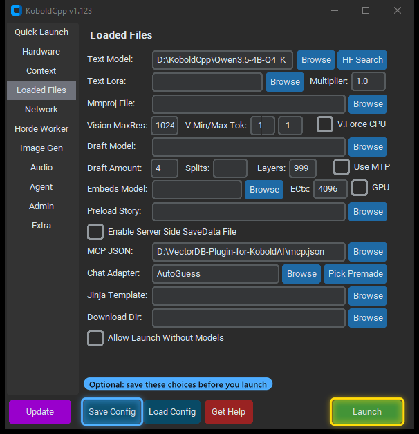</p>

## Part 3: Turn on tool calling in Kobold Lite

### Step 9: Pick a look (first time only)

The first time Kobold Lite opens, it asks you to pick a UI style. Any style works; this guide uses **Classic UI**. Click **Set UI**.

<p align="center">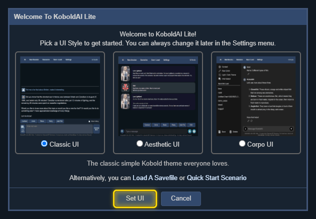</p>

### Step 10: Open Settings

Click **Settings** in the menu bar at the top.

<p align="center">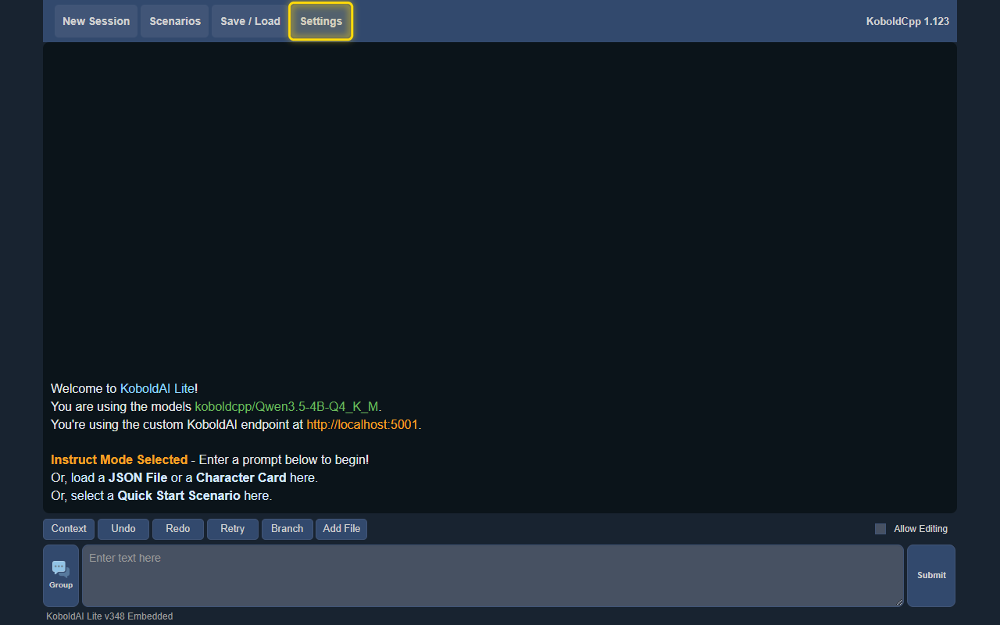</p>

### Step 11: Open the Tools tab

<p align="center">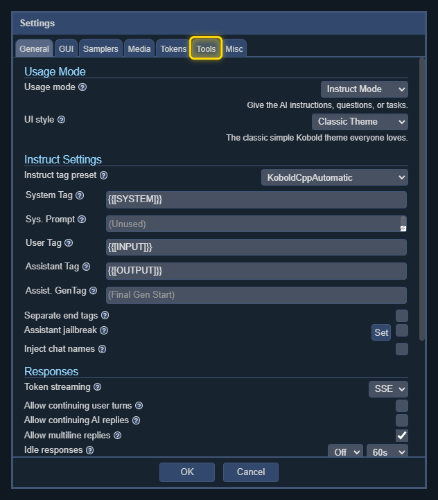</p>

### Step 12: Enable tool calling

1. Tick **Enable Toolcalling**. The program's tools, whose names start with `vectordb_`, appear in the list below. Leave **Include KoboldCpp MCP Bridge** ticked.
2. Click **OK**.
3. Optional, in blue: tick **Automatically Execute Tools** before you click **OK** if you trust this program. The AI then runs its searches without asking you to approve each one.

Kobold Lite remembers these settings in your browser, so you only do this once.

<p align="center">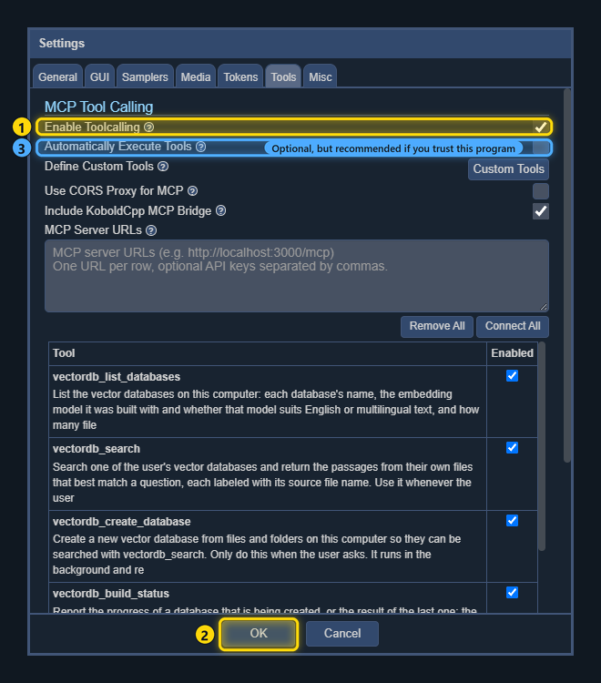</p>

## Part 4: Ask questions

### Step 13: Ask about KoboldCpp

Type a question in the box at the bottom and press Enter. Naming the database helps the AI pick it, for example:

> Search the kobold_wiki database: how do I set up MCP tool calling in KoboldCpp?

### Step 14: Approve the search

Unless you ticked **Automatically Execute Tools**, each tool call waits for you. Click **Approve** to let it run. **Inspect** shows exactly what the AI wants to search for first.

<p align="center"></p>

The AI then answers from the passages it found:

<p align="center">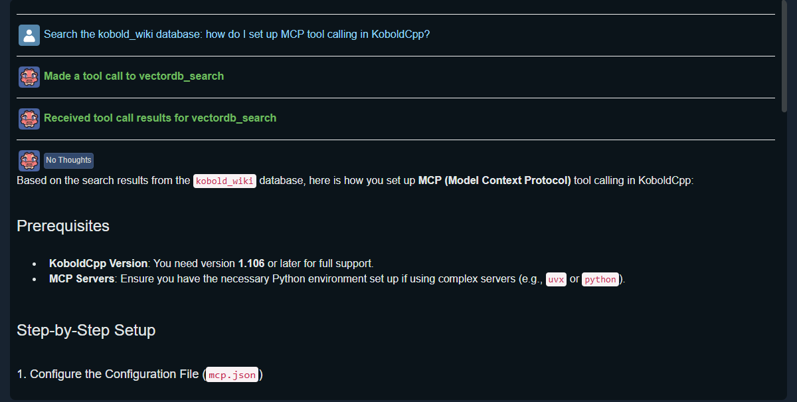</p>

One question can need more than one approval. After each result, KoboldCpp asks the AI whether it needs another tool call before it answers.

### Step 15: Make a database of your own files

Ask the AI to create one, giving it a name and the full path of a folder or file:

> Create a vector database called recipes from the files in D:\Recipes

Approve its calls. The database is built in the background, and the AI can check on it for you. A few files take under a minute; large folders can take much longer, and you can keep chatting meanwhile.

<p align="center">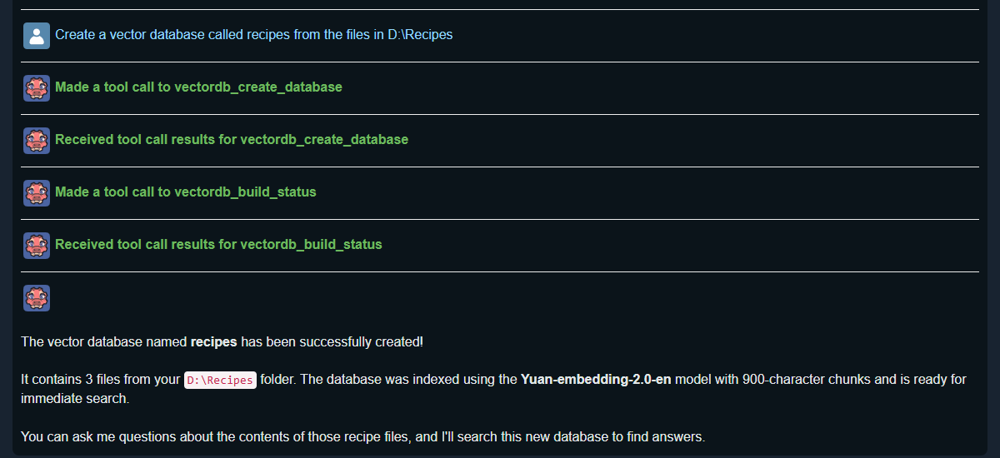</p>

Then ask about your files:

> Search my recipes: how long do I bake the banana bread, and at what temperature?

<p align="center"></p>

The program reads PDF, Word, text, Markdown, HTML, e-mail, spreadsheet, RTF and image files. Images are described by a small vision model, which is downloaded the first time a database includes images.

## Next time

1. Start `koboldcpp.exe`, click **Load Config** and pick the file you saved in Step 8 (or repeat Steps 6 and 7).
2. Click **Launch**.
3. Ask away. Kobold Lite still has tool calling turned on.

## Tips

- **Choose a capable model.** Small models sometimes pick the wrong tool or repeat a search. If the AI repeats exactly the same search within three minutes, the program tells it to use the passages it already has.
- **Ask for more passages.** A search returns 5 passages by default. Ask for a number, such as "search kobold_wiki and give me 10 passages about context shifting", and you'll get up to 20.
- **Scanned PDFs** have no text to search. Mention that your PDFs are scans and the AI can make them searchable first; it saves a searchable copy named `NAME_OCR.pdf` next to each one.
- **The first search is slower**, about 10 seconds, because the embedding model has to load. Later searches are quick.
- **Deleting a database** is only possible from the command line, so the AI can never delete one.

## The command line

Everything the AI can do, and more, is also available from a command prompt. Open one in the `src` folder, activate the virtual environment with `.\Scripts\activate`, then run a command:

| Command | What it does |
|---|---|
| `python cli.py databases` | List your databases |
| `python cli.py create NAME FOLDER --model yuan` | Create a database from a folder |
| `python cli.py search NAME "your question"` | Search a database |
| `python cli.py files NAME` | List the files in a database |
| `python cli.py delete NAME` | Delete a database |
| `python cli.py status` | Show the progress of a database being created |
| `python cli.py models` | List the embedding models and what each is best for |
| `python cli.py settings` | Show or change settings, such as the number of passages per search |
| `python cli.py wiki` | Check whether the KoboldCpp wiki database is current |
| `python cli.py mcp-config` | Save `mcp.json` again, for example after moving the program's folder |

Run `python cli.py --help`, or `python cli.py COMMAND --help` for one command, to see every option.

## Keeping the KoboldCpp wiki database current

Each release of this program comes with the KoboldCpp wiki as it was when the release was made. To check for changes since then:

```bash
python cli.py wiki
```

To download the current wiki and rebuild the database when it has changed:

```bash
python cli.py wiki update
```

## Troubleshooting

- **Kobold Lite's Tools tab says "No tools were found from any reachable server."** KoboldCpp was started without `mcp.json`. Close KoboldCpp and repeat Steps 6 to 8, making sure the **MCP JSON** field shows the file.
- **KoboldCpp's window shows `MCP Init Error` or `MCP Setup Error`.** KoboldCpp couldn't start the program, usually because the program's folder was moved or renamed after `mcp.json` was saved. Run `python cli.py mcp-config` in the activated `src` folder and pick the new `mcp.json` in the launcher.
- **A search says the embedding model isn't downloaded.** Run the `python cli.py download` command it shows.
- **The AI answers without searching.** Name the database in your question, as in the examples above.
- **The AI asks for approval many times.** That's KoboldCpp asking it after every result whether another tool call is needed. Tick **Automatically Execute Tools** (Step 12) if you trust this program.
